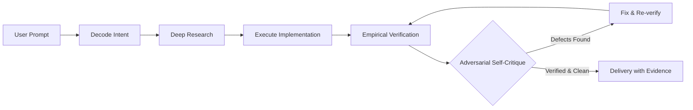

<div align="center">

```
  _    _  ____   ______ 
 | |  | |/ __ \ |  ____|
 | |  | | |  | || |__   
 | |  | | |  | ||  __|  
 | |__| | |__| || |____ 
  \____/ \___\_\|______|
```

### **Universal Quality Engine**
**A cognitive operating system for AI agents.**

[](https://github.com/dollan9/uqe/actions/workflows/ci.yml)
[](https://github.com/dollan9/uqe/releases)
[](LICENSE)
[](docs/benchmarks.md)
[](modules/)
[](CONTRIBUTING.md)

<p align="center">
  <em>Assume nothing. Verify everything. Use the cheapest sufficient evidence.</em>
</p>

[Quick Start](#-quick-start) •
[Why UQE?](#-why-uqe-vs-standard-agents) •
[Quality Loop](#-the-quality-loop) •
[CLI & Doctor](#-unified-uqe-cli) •
[Benchmark](#-uqeb-benchmark) •
[Documentation](docs/)

</div>

---

## ⚡ The Prime Directive

Verbatim from `SKILL.md` Section 0:

> **Assume nothing. Verify everything. Use the cheapest sufficient evidence. Do not ship blind. Do not fabricate. Do not over-process trivial work.**

Evidence is not a feeling. Evidence is a named, inspectable artifact: a screenshot, a rendered frame, a test output, a citation, a diff, or a physical measurement. If the agent cannot name the evidence, it has not verified. If it has not verified, it is not done.

---

## 🚀 Quick Start (Zero Git Cloning Required)

Install UQE into your active project in seconds using your preferred method:

### 🔹 Linux / macOS (One-liner)
```bash
curl -fsSL https://raw.githubusercontent.com/dollan9/uqe/main/install.sh | bash
```

### 🔹 Windows PowerShell (One-liner)
```powershell
irm https://raw.githubusercontent.com/dollan9/uqe/main/install.ps1 | iex
```

### 🔹 Node.js / NPX
```bash
npx uqe init
```

### 🔹 Python / Pip
```bash
pip install uqe && uqe init
```

### 🔹 From Source (Clone)
```bash
git clone https://github.com/dollan9/uqe.git && cd dollan
./install.sh            # or .\install.ps1 on Windows
```

---

## 📊 Why UQE? vs Standard Agents

| Dimension | Standard AI Agent ("The Blind Craftsman") | UQE-Powered Agent ("The Verified Engineer") |
| :--- | :--- | :--- |
| **Completion Claims** | Declares *"I'm all done!"* without testing anything. | **Refuses completion** without inspectable evidence artifacts. |
| **User Intent** | Guesses missing requirements and builds the wrong thing. | Runs an **Ambiguity Audit** first; asks targeted clarifying questions. |
| **Web Verification** | Writes HTML/CSS blind; breaks mobile viewports. | Inspects headless screenshots at **1440px, 768px, and 375px** + a11y audit. |
| **Code Testing** | Writes fake tests (`// TODO: test later`) or hallucinates runs. | Executes real test suites; checks console errors and AST. |
| **Self-Critique** | Acts as an uncritical yes-man. | Runs **adversarial self-critique**; categorizes open defects (P0/P1/P2). |
| **Session Memory** | Forgets your preferences when the context window resets. | Preserves structured preferences in `.uqe/preferences.md`. |
| **Evidence Transparency**| *"Trust me, bro."* | Outputs a structured JSON ledger and **self-contained HTML dashboard**. |

---

## 🔄 The Quality Loop



1. **Decode Intent**: Identifies ambiguities and effort tier (T0 trivial, T1 light, T2 standard, T3 critical).
2. **Deep Research**: Enforces minimum authoritative primary sources before writing non-trivial logic.
3. **Execute**: Clean, production-grade craftsmanship with zero placeholder stubs.
4. **Empirical Verification**: Produces inspectable proof using the cheapest sufficient evidence.
5. **Adversarial Self-Critique**: Hunts for edge cases, performance leaks, and accessibility bugs.
6. **Delivery**: Backed by a verifiable evidence contract conforming to `evidence.schema.json`.

---

## 🛠️ Unified `uqe` CLI

UQE includes a cross-platform command line interface (`uqe`) for agent diagnostics, evidence verification, and reporting.

```text
usage: uqe [-h] [--version] {init,doctor,verify,report,benchmark} ...
```

### `uqe doctor`
Inspect your environment, toolchain health, and active workspace rules:
```bash
uqe doctor
```
```text
============================================================
  UQE DOCTOR -- System & Workspace Diagnostics
============================================================
 [OK]    Python Runtime             : Python 3.11.9
 [OK]    Git VCS                    : git version 2.55.0
 [OK]    Integrity Hashing          : sha256 utility available
 [OK]    Web Domain (Playwright)    : Playwright automation ready
 [OK]    Video Domain (ffmpeg)      : ffmpeg + ffprobe ready
 [OK]    UQE Workspace Rules        : Active targets: Cursor (.cursor/rules/uqe.mdc)
============================================================
 [+] System is healthy and ready for verified agent operations.
```

### `uqe verify`
Validate an agent's evidence report against `evidence.schema.json`:
```bash
uqe verify .uqe/evidence.json
```

### `uqe report`
Generate an executive terminal overview or a **standalone dark-mode HTML dashboard**:
```bash
uqe report .uqe/evidence.json --html artifacts/report.html
```

### `uqe benchmark`
Run the official UQEB test suite verifying anti-hallucination compliance:
```bash
uqe benchmark
```

---

## 🧪 UQEB Benchmark

The **Universal Quality Engine Benchmark (UQEB)** verifies that an agent runtime strictly enforces evidence verification and resists hallucination.

```text
=================================================================
  UQEB -- UNIVERSAL QUALITY ENGINE BENCHMARK SUITE (v3.2)
=================================================================
 [PASS] UQEB-01 : Prime Directive Verbatim Enforcement (0.0ms)
        -> Exact verbatim directive present in Section 0
 [PASS] UQEB-02 : Anti-Hallucination Gate (No-Evidence Rejection) (0.0ms)
        -> Schema strictly forbids empty evidence arrays (minItems >= 1)
 [PASS] UQEB-03 : SEEN Inspection Standard (Concrete Observation Rule) (0.5ms)
        -> Observed string strictly requires minLength >= 10
 [PASS] UQEB-04 : Memory Pruning Structure Preservation (5.0ms)
        -> Header lines explicitly isolated from reverse line truncation
 [PASS] UQEB-05 : Zero-Lockin Neutrality Audit (63.9ms)
        -> Clean: 0 vendor/model hardcodings across 15 normative files
 [PASS] UQEB-06 : Domain Specialization Coverage (0.0ms)
        -> All 7 core domain verification contracts active
-----------------------------------------------------------------
  UQEB RESULT: 6/6 tests passed (100.0% compliance)
  Empirical Hallucination Prevention Score: 100.0 / 100
-----------------------------------------------------------------
```

---

## 🎯 Target Support Matrix

| Target | Command | Written File(s) | Activation Mechanism |
| :--- | :--- | :--- | :--- |
| **Cursor** | `uqe init --target cursor` | `.cursor/rules/uqe.mdc` + `.uqe/` | Rule front-matter (`alwaysApply: false` default; opt in with `UQE_ALWAYS_APPLY=true`) |
| **Claude Code** | `uqe init --target claude` | `CLAUDE.md` + `.uqe/` | Marker-delimited block (`<!-- BEGIN UQE -->` ... `<!-- END UQE -->`) — preserves surrounding user content |
| **Windsurf** | `uqe init --target windsurf` | `.windsurf/rules/uqe.md` + `.uqe/` | Global rules file applied to agent sessions |
| **Copilot / Codex** | `uqe init --target codex` | `AGENTS.md` + `.uqe/` | Standard marker-delimited block |
| **Gemini CLI** | `uqe init --target gemini` | `GEMINI.md` + `.uqe/` | Standard marker-delimited block |
| **Generic / Manual**| `uqe init --target generic` | `.uqe/` | Prints instructions to copy `SKILL.md` into your agent's system prompt |

---

## 📚 Documentation & Modules

- **[Architecture & Core Behavior](references/core-behavior.md)**: Cognitive foundation and anti-guessing audit.
- **[Web Verification](modules/web.md)**: Responsive rendering, viewport breakpoints, console errors, axe-core a11y.
- **[Code Engineering](modules/code.md)**: Static analysis, type safety, test suites, zero mock placeholders.
- **[Video & Multimedia](modules/video.md)**: Keyframe inspection, ffprobe validation, EBU R128 audio loudness.
- **[3D / Blender](modules/blender.md)**: Manifold geometry, degenerate faces, headless rendering.
- **[Deep Research](modules/research.md)**: 3-source cross-referencing, citation validation, counter-evidence hunt.
- **[Preferences & Memory](modules/memory.md)**: Cross-session learning, token pruning, persistent lessons.

---

## 🔎 Supported Ecosystem & Search Keywords

UQE functions as an open standard, portable behavioral plugin and quality engine for the entire AI engineering stack:

- **AI Coding Editors & IDEs**: [Cursor](https://cursor.com) (`.cursor/rules/uqe.mdc`), [Windsurf](https://codeium.com/windsurf) (`.windsurf/rules/uqe.md`), VS Code, GitHub Copilot, [Claude Code](https://claude.ai) (`CLAUDE.md`), Gemini CLI (`GEMINI.md`), OpenAI Codex (`AGENTS.md`).
- **Autonomous Agent Workflows**: Compatible alongside LangGraph, CrewAI, AutoGen, smolagents, MetaGPT, and custom developer pipelines.
- **Search Tags**: `ai-plugins`, `ai-agents`, `cursorrules`, `cursor-rules`, `claude-code`, `windsurf-rules`, `anti-slop`, `ai-quality-assurance`, `llm-hallucination-prevention`, `evidence-based-ai`, `code-generation-benchmarks`, `developer-tools`.

---

## 🛡️ License & Contributing

- **License**: [MIT](LICENSE)
- **Code of Conduct**: [Contributor Covenant 2.1](CODE_OF_CONDUCT.md)
- **Contributing**: Contributions are welcome! See [CONTRIBUTING.md](CONTRIBUTING.md) for guidelines.

